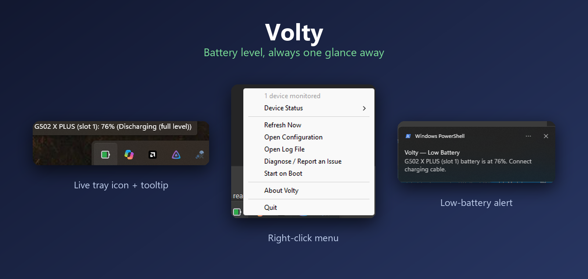

<p align="center">
  
</p>

<h1 align="center">Volty</h1>

<p align="center">Volty is a wireless device battery monitor for Windows. See battery levels for supported mice, headsets, and game controllers in the system tray.</p>

<p align="center">
  <a href="docs/device-support.md#tested-devices">Check your device model</a> ·
  <a href="https://apps.microsoft.com/detail/9np6xlpqmd7b">Microsoft Store</a> ·
  <a href="https://github.com/PhilippPolterauer/volty-rs/releases/latest">Download for Windows</a> ·
  <a href="https://philipppolterauer.github.io/volty-rs/">Documentation</a>
</p>

<p align="center">
  <a href="https://github.com/PhilippPolterauer/volty-rs/releases/latest"></a>
  <a href="https://github.com/PhilippPolterauer/volty-rs/actions/workflows/ci.yml"></a>
  <a href="LICENSE"></a>
</p>



On Windows 10 and 11 (x64), Volty shows the lowest monitored battery level by
default, or you can pin the device you care about most.

The native Rust tray app is optimized to stay small. Volty 0.17.0 used
**about 4 MiB of private RAM** in the tray on one Windows PC. The history
dashboard loads WebView2 on demand, and its processes exit when you close it.
See the [memory measurements](docs/diagnostics.md#memory-footprint).

- **Hover** over the tray icon for each device’s charge and estimated time remaining, when available.
- **Left-click** to open the battery history dashboard and see how quickly your devices drain.
- **Right-click** to choose which devices to monitor, change the tray display, or configure alerts.
- **Get a Windows notification** at 20%, 10%, and 5% by default.

Battery readings and history stay on your PC.

## Install

Before installing, [check your exact model and connection type](docs/device-support.md#tested-devices).

- **Microsoft Store** handles installation and updates. [Get Volty](https://apps.microsoft.com/detail/9np6xlpqmd7b)
- **Standalone** runs without an installer. Download the `Volty-v*-x86_64-pc-windows-msvc.exe` release asset and open it. [Latest release](https://github.com/PhilippPolterauer/volty-rs/releases/latest)

If the tray icon is hidden, open **Show hidden icons** on the Windows taskbar.
The WinGet community package is [pending approval](https://github.com/microsoft/winget-pkgs/pull/484253).

## Device support

Volty reads battery levels from supported Logitech devices, other devices that
report battery levels over HID, XInput gamepads, and Bluetooth devices whose
battery readings Windows exposes. Support varies by model and connection type.
See the [tested devices and known limitations](docs/device-support.md).

The **Logitech G502 X PLUS** reports battery percentage and charging status
over both USB and the LIGHTSPEED receiver. Volty uses the mouse's HID++ unit
ID to show both connections as one device with a single battery history.

If a device is missing, make sure it’s on and connected, then right-click the
tray icon and select **Show Advanced Options → Discover Devices Now**. See the
[troubleshooting guide](docs/diagnostics.md) for more help.

## Build from source

On Windows with Rust 1.99 or newer and the x64 MSVC toolchain, run:

```powershell
cargo build --release --package volty-tray --locked
```

The executable is at `target\release\volty.exe`. The
[development guide](docs/development.md) covers workspace checks and hardware
reports. See the [changelog](CHANGELOG.md) for release notes.

Volty is an independent open source project under the [MIT license](LICENSE).
