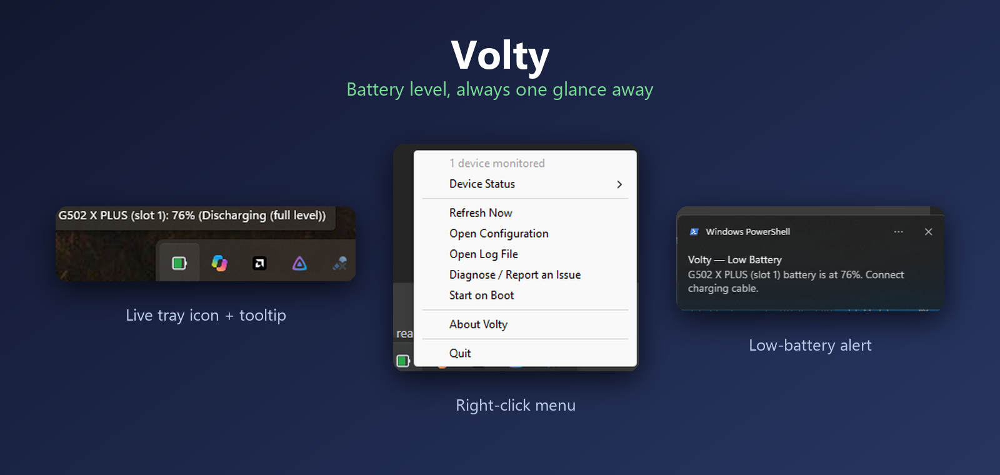
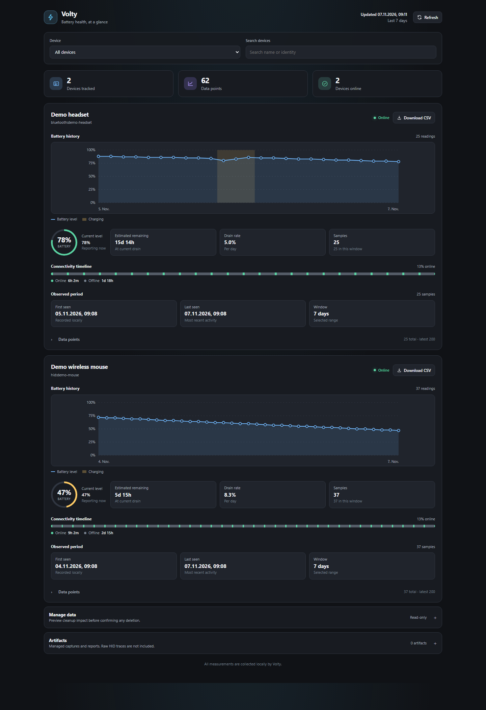
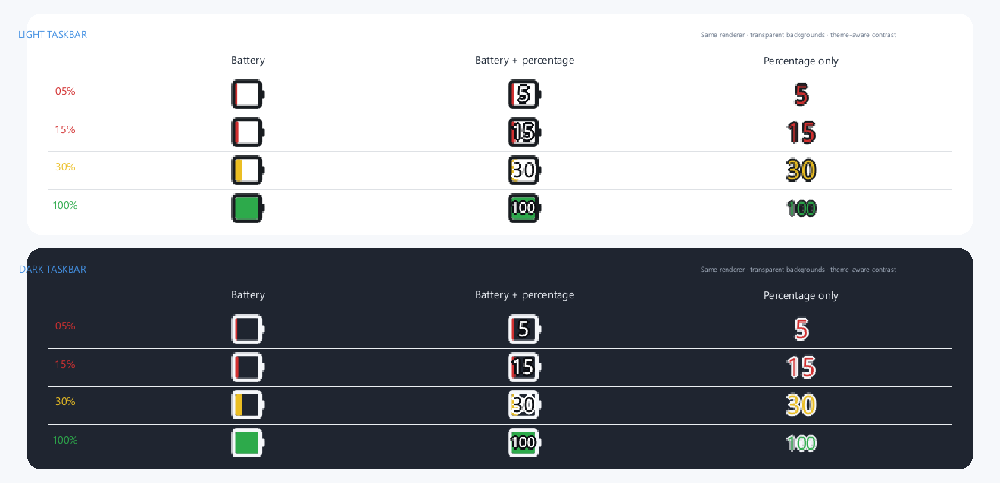

# Volty (`volty-rs`)

<p align="center">
  
</p>

<p align="center">
  <strong>A Windows system-tray battery monitor for supported HID devices, XInput gamepads, and Bluetooth devices, written in Rust.</strong>
</p>

<p align="center">
  <a href="https://github.com/PhilippPolterauer/volty-rs/actions/workflows/ci.yml"></a>
  <a href="https://github.com/PhilippPolterauer/volty-rs/actions/workflows/docs.yml"></a>
  <a href="https://github.com/PhilippPolterauer/volty-rs/releases/latest"></a>
  <a href="LICENSE"></a>
</p>

Your device batteries, always one glance away. Volty sits in the Windows
notification area, shows the live charge level on a theme-aware tray icon, and
warns you before a device dies. It reads supported Logitech HID++, standard HID
battery reports, and coarse XInput gamepad levels on Windows 10/11. Bluetooth
battery readings are available when Windows exposes a supported source.

<p align="center">
  
</p>

> **Project status:** Volty is a hobby project with limited hardware testing. It
> is not production-ready or affiliated with Logitech. Device support and
> readings are best-effort.

## Get started

Download the latest
[Windows release](https://github.com/PhilippPolterauer/volty-rs/releases/latest)
and run the standalone `.exe`. The native dashboard uses the Microsoft
WebView2 Runtime; if it is unavailable, Volty opens the dashboard in your
default browser instead.

**[Read the Volty documentation](https://philipppolterauer.github.io/volty-rs/)**
for installation and usage, supported devices, configuration, troubleshooting,
and development guides.

## Highlights

- **Theme-aware tray:** the battery icon stays readable in light and dark
  Windows themes, and the tray menu follows the system appearance. Hover for
  device name, percentage, estimated time remaining, and status.
- **Tray controls:** manage monitored devices, customize the tray display,
  configure alerts, open diagnostics, and control Start on Boot.
- **Low-battery alerts:** native Windows notifications before you run dry.
- **Battery dashboard:** a responsive, summary-first view of local history,
  battery level, estimated time remaining, and drain rate. Its colors follow
  the system light or dark theme; the native window requires WebView2 and has a
  browser fallback. Nothing is uploaded.

<p align="center">
  
</p>

- **Local data controls:** filter devices, export history as CSV, pause
  recording, and review cleanup before removing stored data.
- **Updates:** get notified when a stable release is available; Volty verifies
  the download before asking to install it.
- **Diagnostics:** read-only hardware captures with local inspection and
  replay; nothing is uploaded automatically.
- **Modular Rust workspace:** separate battery, HID, Bluetooth, capture, and
  tray crates.

<p align="center">
  
</p>

Device support is best-effort beyond the hardware listed in the
[device support guide](https://philipppolterauer.github.io/volty-rs/device-support.html).
Bluetooth support depends on the battery data Windows exposes for each device;
the support guide lists validated examples and current limitations.

## Build and test

Windows 10/11 and Rust 1.99 or newer are required to build the tray app.

```powershell
cargo build --release --package volty-tray --locked
cargo test --workspace --all-features --locked
```

See the [development guide](https://philipppolterauer.github.io/volty-rs/development.html)
for CI checks and hardware-testing notes.

## Project links

- [Documentation site](https://philipppolterauer.github.io/volty-rs/)
- [Releases](https://github.com/PhilippPolterauer/volty-rs/releases)
- [Changelog](CHANGELOG.md)
- [License](LICENSE)
