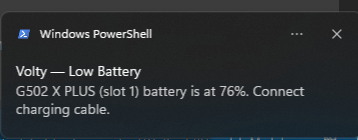
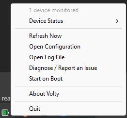

# Volty (`volty-rs`)

<p align="center">
  
</p>

<p align="center">
  <strong>A Windows system-tray battery monitor for supported HID devices, written in Rust.</strong>
</p>

<p align="center">
  <a href="https://github.com/PhilippPolterauer/volty-rs/actions/workflows/ci.yml"></a>
  <a href="https://github.com/PhilippPolterauer/volty-rs/releases/latest"></a>
  <a href="LICENSE"></a>
</p>

<p align="center">
  <a href="#features">Features</a> •
  <a href="#using-a-released-binary">Usage</a> •
  <a href="#architecture">Architecture</a> •
  <a href="#quick-start">Quick Start</a> •
  <a href="#building-and-testing">Building</a> •
  <a href="#releases">Releases</a> •
  <a href="CHANGELOG.md">Changelog</a> •
  <a href="#license">License</a>
</p>

---

## Current support

Volty supports Logitech HID++ 2.0 interfaces on Windows 10/11. The Bluetooth
tray integration is disabled by default because it is not working as intended
and has not been tested; do not rely on it. To opt into this experimental code
in a local build, pass the tray crate's `bluetooth` feature:

```powershell
cargo run --release --package volty-tray --features bluetooth
```

Other vendor HID protocols, generic HID battery reports, classic Bluetooth HFP
battery indications, and vendor-specific Bluetooth protocols are not currently
supported.

> **Project status:** Volty is a vibe-coded hobby project. It is experimental,
> has limited hardware testing, and is not production-ready or affiliated with
> Logitech. Treat device support and battery readings as best-effort.

---

## Features

* **HID++ Battery Monitoring:** Polls supported Logitech interfaces and paired-device indexes, prioritizes recently successful receiver slots from a machine-local SQLite cache, and uses each device's HID++ name when available.
* **Battery Runtime Estimate:** Estimates time remaining from the recent discharge rate, using a configurable history window (10 minutes by default).
* **Experimental Bluetooth integration:** Opt-in via the `bluetooth` Cargo feature and currently not working as intended or tested; it is disabled in default builds.
* **Configurable Color Coding:** The default tray map is green above 30%, yellow from 16–30%, and red at 15% or below. Thresholds and colors can be overridden in the TOML configuration.
* **Threshold Alerts:** One-time native Windows toast notification per discharge cycle when battery hits warning thresholds.
* **One-Click Diagnostics:** A native Diagnose window shows recent app logs, backend status, and HID details, with buttons to copy the log or open a GitHub issue draft.
* **Retry After Read Errors:** Polling resumes after errors using the configurable retry interval.
* **Per-Device Control:** Choose which discovered devices are monitored from the tray's **Monitored Devices** submenu; the choice is persisted locally.
* **Self-Maintaining Logs:** The local log file rotates at 5 MiB and keeps one `.1` backup.
* **Standalone Executable:** Releases provide a single `.exe` with no installer. Optional Start on Boot uses the current user's Windows Run setting.

---

## Using a released binary

Download the latest
[Volty release](https://github.com/PhilippPolterauer/volty-rs/releases/latest).
For a standard 64-bit Windows PC, download the asset named
`Volty-vX.Y.Z-x86_64-pc-windows-msvc.exe` (the version number changes with
each release). The `.sha256` file alongside it contains the executable's
SHA-256 checksum for verification. Volty is a standalone executable; there is
no installer or additional runtime file to download.

Save the executable where you want to keep it, then double-click it. Volty
starts directly in the Windows notification area without opening a terminal.
On first launch, choose whether to start Volty automatically when you sign in.
That choice is remembered and can be changed at any time using **Start on
Boot** in the tray menu. If enabled, Windows starts Volty from the executable's
current location, so keep the file there. Volty monitors supported Logitech
HID++ devices while running. Bluetooth is disabled in the default build and is
currently not working as intended or tested. Its tray icon shows the lowest
reported battery level; hover over it for device names, charging status, and
an estimated time remaining after enough discharge history has accumulated.


Low-battery alerts appear as Windows notifications. They are enabled by
default and can be configured or disabled in Volty's configuration file.



Right-click the tray icon to discover devices and refresh readings
(**Discover Devices Now**), choose **Monitored Devices**, open configuration or
logs, view diagnostics, enable **Start on Boot**, see **About Volty**, reset
Volty, or quit the app. **Start on Boot** toggles startup for the current
Windows user and does not require administrator privileges.



Configuration and logs are stored in `%APPDATA%\Volty`. Choose
**Open Configuration** or **Open Log File** in the tray menu to access them.
For troubleshooting, choose **Diagnose / Report an Issue**; review the report
before sharing it. Nothing is uploaded automatically.
**Reset Volty** asks for confirmation before deleting
`%APPDATA%\Volty\config.toml` and
`%LOCALAPPDATA%\Volty\device-state.sqlite3`. It also disables **Start on Boot**
and clears the first-run startup prompt preference, then reinitializes Volty in
place with fresh defaults. The startup prompt appears again the next time
Volty launches; logs are retained.

---

## 🏗️ Architecture

`volty-rs` is structured as a modular Cargo workspace, keeping hardware protocol handling strictly separated from UI rendering:

```text
volty-rs/
├── crates/
│   ├── volty-battery/         # Dependency-free BatteryStatus, DeviceId and the BatteryProvider trait
│   ├── volty-bluetooth/       # Windows Bluetooth provider (classic, SetupAPI, BLE phases under a shared scan budget)
│   ├── volty-hid/             # Zero-UI, zero-Win32 protocol crate
│   │   ├── src/
│   │   │   ├── lib.rs         # Module root and public re-exports
│   │   │   ├── interface.rs   # HID interface metadata, selectors and stable interface keys
│   │   │   ├── hid.rs         # Optional hidapi device enumeration and sessions
│   │   │   ├── device.rs      # Device name and feature queries
│   │   │   ├── protocol.rs    # Protocol/device traits and support catalog
│   │   │   ├── profile.rs     # Device profile parsing (`profile` feature)
│   │   │   ├── command.rs     # HID++ feature commands (`profile` feature)
│   │   │   ├── logitech_hidpp.rs # HID++ 2.0 transport and battery backend
│   │   │   └── battery.rs     # HID++ battery decoding
│   │   └── Cargo.toml
│   │
│   └── volty-tray/            # Windows binary application
│       ├── build.rs           # Embeds the Windows application manifest and icon
│       ├── volty.manifest
│       ├── assets/
│       │   └── volty.ico      # Windows application icon
│       ├── src/
│       │   ├── main.rs        # CLI dispatch and single-instance guard
│       │   ├── hid_cli.rs     # On-demand HID++ interface/feature diagnostics
│       │   ├── app.rs         # Event loop and application state
│       │   ├── app/           # Device session, polling worker, battery ETA, notifications, labels
│       │   ├── provider.rs    # Battery providers the tray polls (HID, optional Bluetooth)
│       │   ├── provider/      # HID provider (stable identity, slot probing) and device-name cache
│       │   ├── config.rs      # Per-user TOML settings
│       │   ├── state.rs       # Local SQLite device and notification runtime state
│       │   ├── tray.rs        # Tray controller and context menu
│       │   ├── tray/          # Icon rendering and start-on-boot registry handling
│       │   ├── about.rs       # About window
│       │   ├── diagnose.rs    # Native diagnostic window and clipboard actions
│       │   ├── win32.rs       # Shared Win32 window and control helpers
│       │   ├── native_ui.rs   # Native message boxes and icon helpers
│       │   ├── report.rs      # Local diagnostic report generation
│       │   ├── logging.rs     # Level-filtered local log file
│       │   └── notify.rs      # Windows toast dispatcher
│       └── Cargo.toml
│
└── Cargo.toml                 # Workspace manifest
```

### Runtime data flow

```text
HID interface enumeration        Bluetooth battery discovery
        |                                |
        v                                ├── Windows battery-life property (optional)
SUPPORTED_HID_DEVICES -> BatteryProtocol └── Windows-paired BLE GATT Battery Service (optional)
        |                                |
   HidProvider                    BluetoothProvider
        |                                |
        └────────────────┬───────────────┘
                         v
        BatteryProvider -> DeviceId + DeviceLabel + BatteryStatus
                         |
        DeviceSession (poller thread, readings, ETA)
                         |
             tray state, icon, notifications
```

`volty-battery` defines the transport-neutral vocabulary: `BatteryStatus`
(its `source` is a plain label set by the backend), the stable `DeviceId`, and
the `BatteryProvider` trait. A provider yields readings keyed by `DeviceId`;
the tray consumes only that and never sees HID++ opcodes, device indices or
interface paths. A new source (headphones, another HID family) implements
`BatteryProvider` and is added to `default_providers` in the tray; it does not
extend the HID catalog or add a branch to the poller.

`volty-hid` owns HID protocol behavior: `BatteryProtocol` implements interface
matching, device-address iteration, and the protocol-specific battery query.
`HidBatteryDevice` associates a device family with a backend. The
`SUPPORTED_HID_DEVICES` catalog is the HID dispatch source: an interface must
match exactly one device; no match is skipped and overlapping matches are
reported. Its current catalog contains one Logitech HID++ 2.0 device.

HID identity does not depend on the Windows interface path, which changes when
USB re-enumerates. `stable_interface_keys` derives a key from VID/PID,
interface number, usage page/usage and (when present) a hash of the serial
number; indistinguishable twins are split deterministically. The tray's cache,
monitor flags and low-battery alert de-duplication all key off
`hid:{stable key}#{slot}`.

`volty-bluetooth` contains experimental Windows Bluetooth battery discovery,
exposed to the tray as `BluetoothProvider`. The tray only compiles and polls
it when built with `--package volty-tray --features bluetooth`. This
integration is currently not working as intended and is untested; the default
build does not include or poll it. It stays feature-gated until a single
Windows reading is reliable and has a stable device identity; until then its
three probes (battery-life property, SetupAPI, paired GATT) are an
implementation detail contained inside the crate. Its intended scope and
implementation notes are in
[Bluetooth headphone battery support](./docs/bluetooth-headphone-battery-support.md).

`volty-tray` owns polling, configuration, tray presentation, and
notifications. Its `build.rs` embeds `volty.manifest` in Windows builds.
The `volty hid` diagnostic commands (the `profile` feature of `volty-hid`)
inspect interfaces and feature mappings or send explicitly authorized raw
HID++ requests. They are separate from tray polling and do not select or
register battery backends.

The tray is Windows-only and does not pretend otherwise: `rusqlite` state is
only built for `x86_64-pc-windows-msvc`. Three native surfaces are in play:
`hidapi` (HID), `windows-sys` (Win32 UI) and `windows` (WinRT Bluetooth).

Adding a device that shares the existing HID++ wire protocol requires a specific
`HidBatteryDevice` matcher and a catalog entry. `HidBatteryDevice` supplies the
family name, backend, and interface match (`matches` can override the default
backend match). Add it to `SUPPORTED_HID_DEVICES`; that is the only HID
dispatch catalog.

A new wire protocol needs a new `BatteryProtocol`; a new encoding on an
existing protocol can extend that backend. Its `supports_interface`
identifies candidate interfaces, `device_indices` returns addresses to try,
and `query_battery` performs discovery/transport/decoding and returns a
normalized `BatteryStatus`. Set `level_percent` only when the device really
reports a percentage. Add or update a `HidBatteryDevice` and register it in
`SUPPORTED_HID_DEVICES` when the interface needs a new or more specific match. The
existing tray code consumes `BatteryStatus`, so a new backend does not need a
tray/UI trait or a protocol-specific icon.

If an existing model already matches the interface and its backend already
reads the device's battery feature, no new trait implementation is needed.
An on-demand diagnostic command alone never registers tray support. See
[Generic HID battery-level support](./docs/hid-battery-support.md) for the
extension flow and current limitations.

## Quick start

Run the application on Windows from the workspace root:

```powershell
cargo run --release --package volty-tray
```

The first battery query is made at startup; subsequent polling occurs every two
minutes by default. Volty runs a single tray-app instance. The tray lists all
monitored devices with readable battery status; its icon reflects the lowest
reported percentage. Use **Monitored Devices** in the tray menu to uncheck
devices you do not want tracked; unchecked devices are omitted from the tray
status, icon percentage, and low-battery notifications. Per-device choices are
saved in the local SQLite state database at
`%LOCALAPPDATA%\Volty\device-state.sqlite3`; unlisted devices are monitored by
default. Legacy `[monitored_devices]` entries in `config.toml` are migrated to
SQLite on startup and removed after a successful migration. The menu also lets
you discover devices, open configuration, enable startup, or quit. **About Volty** opens
a small native window with the app version and a button to visit the project on
GitHub.
The database also remembers which devices have already received a low-battery
alert in their current discharge cycle, preventing repeat alerts after a
restart; a charging or full reading clears that runtime state.

Low-battery alerts default to 20% and fire once per discharge cycle. Select
**Open Configuration** in the tray menu to create or open
`%APPDATA%\Volty\config.toml` in your default editor (Notepad is used if no
editor is associated with `.toml` files). Supported settings are:

```toml
low_battery_threshold = 20 # 1-100 percent
poll_interval_seconds = 120 # 10-3600 seconds after a successful reading
retry_interval_seconds = 15 # 5-300 seconds after an error
ui_poll_interval_ms = 250 # 50-1000 milliseconds between tray-loop checks
battery_eta_window_minutes = 10 # 1-180 minutes of discharge history
notifications_enabled = true
log_level = "info" # error, warn, info, debug, or trace

# Optional tray color-map overrides. Uncomment the table and any values to activate.
# Thresholds are inclusive upper bounds; red_max_percent must be below yellow_max_percent.
# Colors use #RRGGBB notation.
# [battery_color_map]
# red_max_percent = 15
# yellow_max_percent = 30
# red = "#d23030"
# yellow = "#ebbe23"
# green = "#2daa4b"
```

Settings are stored per-user and do not require administrator privileges.
Volty watches the file for changes, and **Discover Devices Now** also reloads it.
Invalid settings are reported while the last valid configuration stays active.
Battery ETA appears after a full configured history window of discharging
readings; it is hidden while charging or when the recent level trend cannot
produce a reliable estimate.
The default tray color map matches the green/yellow/red ranges above; uncomment
`[battery_color_map]` to override its cutoffs or colors. Any omitted values
retain their defaults. The red and yellow cutoffs can be set from 0–99 and
1–100 percent respectively, and must be ordered so red is lower than yellow.
Colors must be six-digit hexadecimal RGB values such as `"#d23030"`.
Logs append to `%APPDATA%\Volty\volty.log`; choose **Open Log File** in the tray
menu to view them. The default `info` level records lifecycle and errors,
`debug` adds successful battery readings, and `trace` adds low-level event
details. Changes to `log_level` take effect when the config is reloaded.

Choose **Diagnose / Report an Issue** in the tray menu to open a native Windows
window with recent application events, the active configuration, Bluetooth
read status, and HID interfaces visible to hidapi. The report includes HID
device IDs, usage information, and available manufacturer/product names, but
omits HID paths, serial numbers, and Bluetooth device IDs/addresses. Review
the contents before sharing; nothing is uploaded automatically. **Copy Log**
copies the report to the clipboard, while
**Open Issue** starts a GitHub issue draft. A local copy is saved under
`%APPDATA%\Volty\reports`.

## HID diagnostics

The `volty` executable also has explicit, on-demand HID++ diagnostics. These
commands run before the tray app's single-instance check; launching `volty`
without a `hid` subcommand still starts the normal tray app.
For the first worked backend example—verifying a Logitech mouse or adding
support for a different HID++ battery feature—see
[Adding a Logitech mouse](./docs/adding-mice.md).
For the generic HID battery-monitoring architecture and backend extension
points, see
[Generic HID battery-level support](./docs/hid-battery-support.md).

```powershell
volty hid inspect
volty hid inspect --vid 0x046d --pid 0xc547 --usage-page 0xff00 --usage 0x0002
volty hid features --vid 0x046d --pid 0xc547 --usage-page 0xff00 --usage 0x0002 --device-index 0x01
volty hid raw --device-index 0x01 --feature-index 0x06 --function-index 1 --report-type long --params 00,00,00,00,00,00,00,00,00,00,00,00,00,00,00,00 --allow-state-changing --vid 0x046d --pid 0xc547 --usage-page 0xff00 --usage 0x0002
```

`inspect` prints matching interfaces' VID/PID, usage page/usage, interface
number, bus, product name, and hidapi path. The path is shown only by this
explicit diagnostic; serial numbers are never printed. hidapi does not expose
report lengths here, so Volty does not infer or display them. Selectors accept
`--vid`, `--pid`, `--usage-page`, `--usage`, `--interface`, and `--path`.
Commands that open a device require exactly one interface match: if a selector
is missing or ambiguous, use `inspect` to narrow it. Do not confuse the USB
interface number with the HID++ `--device-index`, which addresses a paired
device behind a receiver.

`features` queries the device's Root/FeatureSet mappings and prints each
logical feature ID alongside its dynamically assigned runtime index, type, and
version. Runtime indexes can vary by device and must not be copied from one
device to another. On one tested receiver, logical Battery
feature `0x1004` resolved to runtime index `0x06`, version `0x03`, and the
status decoder reported 78%; that mapping is an observation, not a constant.

`raw` accepts only exact HID++ report payload sizes: 3 parameter bytes for a
short report or 16 for a long report. It requires
`--allow-state-changing` because arbitrary raw requests cannot be safely
classified as read-only from their bytes alone, and it prints a warning before
transmission. Prefer `inspect` and `features` for discovery; use `raw` only
when those commands do not provide the needed information.

Interface usage combinations and report behavior are device-specific. For
example, one tested `046D:C547` receiver exchanged valid 20-byte HID++ reports
on usage `FF00/0002`, while `FF00/0001` accepted a 7-byte write without a
matching response. This observation is not a universal rule for other
receivers or devices; select the interface that responds correctly on the
particular system. CLI output is local and is not uploaded. Review any
diagnostic output before sharing it. To save a local transcript in PowerShell,
pipe a command to `Tee-Object .\volty-hid.log`; inspect the file before sharing
it because diagnostic interface paths can identify local devices.

## Building and testing

Prerequisites: Windows 10/11 and the `x86_64-pc-windows-msvc` Rust toolchain
(Rust 1.89 or newer; the stable channel is recommended). The release binary is
written to `target\release\volty.exe`.

```powershell
cargo build --release --package volty-tray
cargo test --workspace
```

CI runs the same checks on every push and pull request, plus a build with the
`bluetooth` feature:

```powershell
cargo fmt --all -- --check
cargo clippy --workspace --all-targets --all-features -- -D warnings
cargo test --workspace
cargo build -p volty-tray --features bluetooth
```

See the [sustained-run performance assessment](./docs/performance-assessment.md)
for one-minute resource measurements and polling-path limitations.

## Releases

User-facing changes are tracked in [CHANGELOG.md](./CHANGELOG.md).

To cut a release, bump the workspace crates' version, move the
`[Unreleased]` changelog entries under the new version heading, commit, and
push a matching tag such as `v0.2.1`. The Windows release workflow verifies the
tag against the `volty-tray` package version, runs format, Clippy, and test
checks, and publishes a standalone `x86_64-pc-windows-msvc` executable with a
SHA-256 checksum to the GitHub Release. No installer or sidecar runtime files
are required.

Protocol-frame unit tests use mock byte buffers and do not require a connected
mouse. Device communication and tray behavior should be verified on Windows
with compatible Logitech Lightspeed hardware.

## License

All crates are released under the [MIT License](LICENSE).
