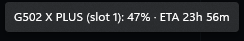

# Volty

<p align="center">
  
</p>

<p align="center">
  <strong>See supported device battery levels right in the Windows system tray.</strong>
</p>

<p align="center">
  <a href="https://github.com/PhilippPolterauer/volty-rs/releases/latest">Download for Windows</a>
  ·
  <a href="https://philipppolterauer.github.io/volty-rs/">Documentation</a>
</p>

<p align="center">
  <a href="https://github.com/PhilippPolterauer/volty-rs/actions/workflows/ci.yml"></a>
  <a href="https://github.com/PhilippPolterauer/volty-rs/releases/latest"></a>
  <a href="LICENSE"></a>
</p>

Volty monitors battery levels from supported mice, headsets, and gamepads. Its
tray icon shows the lowest monitored battery by default; hover for device
details, and get a Windows notification when a battery runs low. Battery data
and history stay on your PC.

<p align="center">
  
  
</p>

## Get it running

1. [Download the latest release](https://github.com/PhilippPolterauer/volty-rs/releases/latest). For a 64-bit PC, choose `Volty-vX.Y.Z-x86_64-pc-windows-msvc.exe`.
2. Save the file where you want it and double-click to run. No installer or administrator access is needed. On first launch, choose whether Volty should start when you sign in.
3. Find the battery icon in the Windows notification area. If it is hidden, open the taskbar's **Show hidden icons** menu.

## Use the tray icon

- **Battery level:** the icon represents the lowest reported level among
  monitored devices. Hover to see device names, percentages, and estimated
  remaining time when available.
- **Customize:** right-click Volty and choose **Show Advanced Options → Tray
  Display** to choose a battery or percentage icon, set a light/dark/system
  theme, or pin a device.
- **Alerts:** Windows notifications appear at 20%, 10%, and 5% by default.
- **History:** left-click the icon to open the local battery dashboard.

If no reading appears, right-click **Monitored Devices** to see which devices
Volty found and which are enabled. To scan again, use **Show Advanced Options →
Discover Devices Now**. Volty can only read battery data exposed by Windows
from supported devices.

Volty supports Windows 10/11, but device compatibility varies. See the
[tested devices and limitations](https://philipppolterauer.github.io/volty-rs/device-support.html)
before relying on it. Volty is an independent hobby project and is not
affiliated with Logitech.

## More

- [Installation and usage](https://philipppolterauer.github.io/volty-rs/installation.html)
- [Configuration](https://philipppolterauer.github.io/volty-rs/configuration.html)
- [Troubleshooting](https://philipppolterauer.github.io/volty-rs/diagnostics.html)
- [Releases](https://github.com/PhilippPolterauer/volty-rs/releases)
- [Changelog](CHANGELOG.md)

<details>
<summary>Build from source</summary>

Requires Windows 10/11 and Rust 1.99 or newer.

```powershell
cargo build --release --package volty-tray --locked
cargo test --workspace --all-features --locked
```

See the [development guide](https://philipppolterauer.github.io/volty-rs/development.html)
for the full validation steps.

</details>
