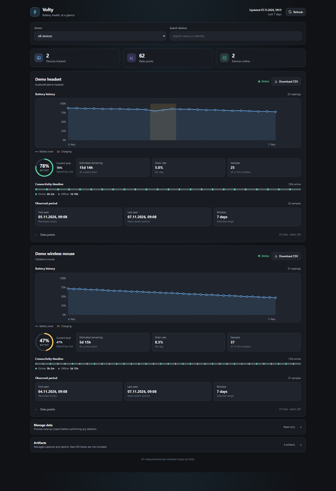

# Volty

  

Volty is a Windows system-tray battery monitor for supported HID devices and
XInput gamepads, written in Rust. It reads supported Logitech HID++, standard
HID battery reports, coarse XInput battery levels, and an experimental
Bluetooth provider enabled by default. Bluetooth hardware validation is
limited to one Classic headset; BLE GATT has not been validated on hardware.

Volty is a hobby project with limited hardware validation. Device support and
battery readings are best-effort; Volty is not production-ready and is not
affiliated with Logitech.

## Start here

- [Install the latest release](installation.md)
- [See verified and experimental devices](device-support.md)
- [Configure Volty](configuration.md)
- [Troubleshoot or report a device](diagnostics.md)

## At a glance

- Windows 10/11, 64-bit x86; standalone executable, no installer.
- Battery tray icon, per-device monitoring, configurable low-battery alerts,
  estimated time remaining, and local history.
- Left-click the tray icon to open the local battery-history dashboard in a
  native WebView2 window, with a browser fallback; right-click for device stats
  and other actions.
- Hardware captures can be inspected and replayed locally; Volty never uploads
  diagnostics automatically.
- The default build monitors HID devices, XInput gamepads, and Bluetooth
  devices. Bluetooth remains experimental with limited hardware validation.

## Battery history dashboard

The local dashboard shows recent battery levels, estimated remaining time, and
history charts. Open it by left-clicking the tray icon or run
`volty dashboard`; see [dashboard options and details](diagnostics.md#battery-history-dashboard).
Dashboard data stays on your device.

## Technical reference

For project architecture, protocol support, and development information, see
the [technical reference](architecture.md) and its related pages in the sidebar.

Get the executable from the
[latest GitHub release](https://github.com/PhilippPolterauer/volty-rs/releases/latest).
For project changes, see the
[changelog](https://github.com/PhilippPolterauer/volty-rs/blob/main/CHANGELOG.md).
