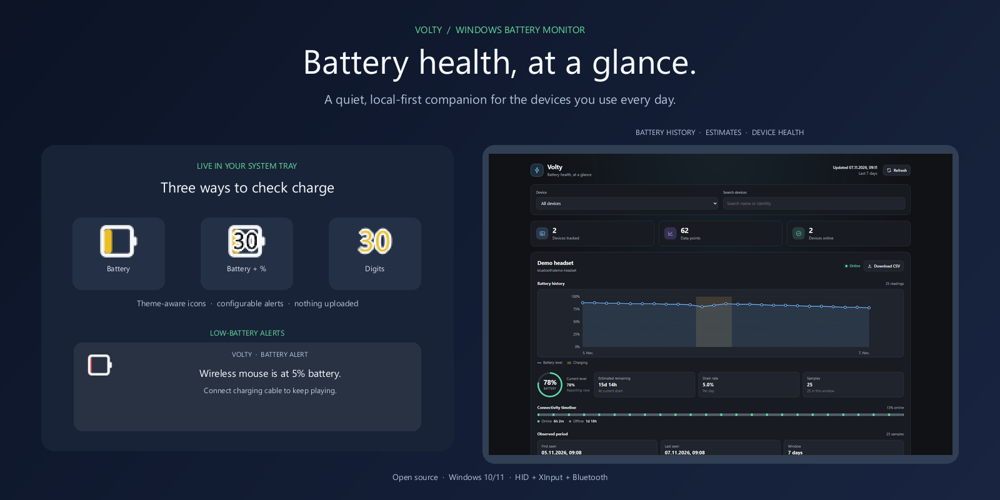
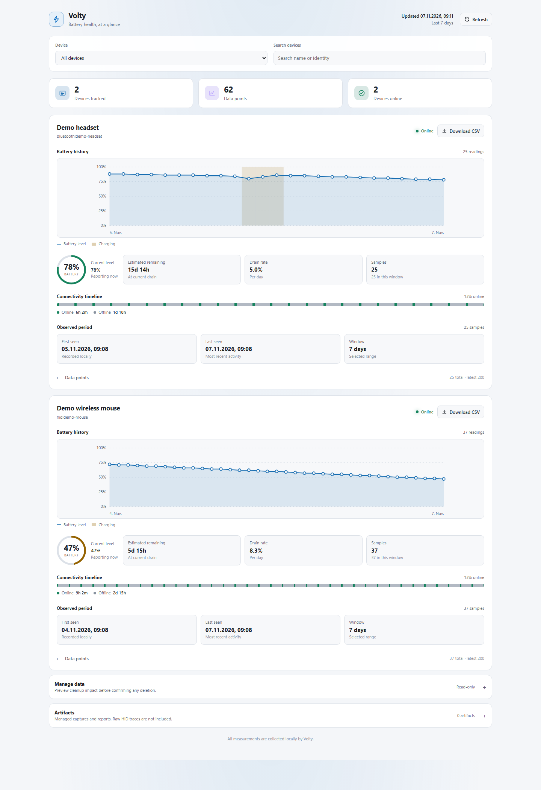

# Volty

  

Volty is a Windows system-tray battery monitor for supported HID devices and
XInput gamepads, written in Rust. It reads supported Logitech HID++, standard
HID battery reports, coarse XInput battery levels, and Bluetooth battery data
when Windows exposes a supported source. Bluetooth is enabled in the default
tray build; validated examples and limitations are listed in the device guide.

Volty is a hobby project with limited hardware validation. Device support and
battery readings are best-effort; Volty is not production-ready and is not
affiliated with Logitech.

## Start here

- [Install the latest release](installation.md)
- [See tested devices and support limits](device-support.md)
- [Configure Volty](configuration.md)
- [Troubleshoot or report a device](diagnostics.md)

## At a glance

- Windows 10/11, 64-bit x86; standalone executable, no installer.
- Theme-aware battery tray icon and menu, per-device monitoring, configurable
  low-battery alerts, estimated time remaining, and local history.
- Left-click the tray icon to open the responsive battery-history dashboard in
  a native WebView2 window, with a browser fallback; right-click for device
  stats and other actions.
- Hardware captures can be inspected and replayed locally; Volty never uploads
  diagnostics automatically.
- The default build monitors HID devices, XInput gamepads, and Bluetooth
  devices when Windows exposes a supported battery source.

## Battery history dashboard

The summary-first dashboard shows tracked devices, data points, online status,
and per-device battery level, estimated remaining time, drain rate, and history
charts. Filter the view by device or search for a device name or identity. Its
colors follow the Windows light or dark appearance. Open it by left-clicking the
tray icon or run `volty dashboard`; see
[dashboard options and details](diagnostics.md#battery-history-dashboard).
Dashboard data stays on your device.

## Technical reference

For project architecture, protocol support, and development information, see
the [technical reference](architecture.md) and its related pages in the sidebar.

Get the executable from the
[latest GitHub release](https://github.com/PhilippPolterauer/volty-rs/releases/latest).
For project changes, see the
[changelog](https://github.com/PhilippPolterauer/volty-rs/blob/main/CHANGELOG.md).
