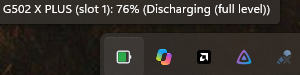
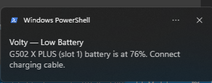

# Install and run

## Download a release

Download the latest
[Volty release](https://github.com/PhilippPolterauer/volty-rs/releases/latest).
For a standard 64-bit Windows PC, choose
`Volty-vX.Y.Z-x86_64-pc-windows-msvc.exe`. The matching `.sha256` file contains
the executable's SHA-256 checksum. Volty is a standalone executable; no
installer or additional runtime file is needed.

Save the executable where you want to keep it, then double-click it. Volty
starts in the Windows notification area. To start it automatically when you
sign in, open **Settings...** from the tray icon and enable **Start with
Windows**. This setting applies to the current Windows user and does not
require administrator privileges. If enabled, Windows starts Volty from the
executable's current location, so keep the file there. If you launch a
different Volty copy while startup is enabled, Volty asks whether to change the
startup entry to that executable; declining leaves the existing entry
unchanged. If you manually install a newer release in a different location,
launch it and confirm the change. The in-app updater replaces the executable
in place, preserving the startup path; its restart does not show a second
confirmation.

## Install through WinGet

Once the package is listed in the WinGet community source, install it with:

```powershell
winget install --id PhilippPolterauer.Volty --exact --source winget
volty
```

Quit Volty from the tray before running
`winget upgrade --id PhilippPolterauer.Volty --exact --source winget`. WinGet
installs the portable executable for your Windows user and handles upgrades.

## Microsoft Store

The Microsoft Store package receives updates through the Store. To start this
edition at sign-in, enable **volty-rs** in **Windows Settings → Apps → Startup**.

## Ubuntu 24.04 LTS

For a preview, download and extract the `linux-amd64-deb` artifact from the
branch's successful GitHub Actions CI run. Tagged releases built with Linux
support include `Volty-vX.Y.Z-linux-amd64.deb` and its matching `.deb.sha256`
on the [releases page](https://github.com/PhilippPolterauer/volty-rs/releases).
From the download directory, replace `X.Y.Z` with the release version:

```sh
sha256sum --check Volty-vX.Y.Z-linux-amd64.deb.sha256 &&
  sudo apt install ./Volty-vX.Y.Z-linux-amd64.deb
```

Open **Volty** from the applications menu or run `volty tray` as your desktop
user. The tray icon requires a desktop session with StatusNotifierItem
support, such as GNOME with the AppIndicator extension enabled. If a
supported USB HID device was already plugged in, run
`sudo udevadm control --reload-rules` and reconnect the device so udev can
apply the packaged access rule.

Verify the package version with `dpkg-query -W volty` and the executable
with `volty --help`. To check desktop integration, open Volty in your desktop
session and confirm that its tray icon appears.

- `volty status` prints live peripheral readings and their sources.
- `volty history --csv` shows samples collected while the tray was running.
- `volty dashboard --open` exports the dashboard and opens it in your browser.
- `volty autostart enable` starts the installed tray at login for the current
  user. Use `volty autostart disable` to turn it off.

Quit Volty and install the newer verified `.deb` with the same `apt install`
command to upgrade. Use `sudo apt remove volty` to remove it. Both operations
preserve user data in `$XDG_STATE_HOME/volty`, which defaults to
`~/.local/state/volty` when `XDG_STATE_HOME` is unset.

## Use the Windows tray app

Volty monitors supported devices while it runs. The icon shows the lowest
reported battery level by default; you can pin a device or choose a numeric
percentage icon. Hover over the icon for a compact line per device, including
its name, percentage, estimated remaining time when available, and last-seen age.
The battery icon adapts its outline for readability in light and dark Windows
themes, and percentage digits use Segoe UI. A reading is marked `stale` after
the configured stale period.



### If no battery reading appears

The tray status **No battery readings · check Monitored Devices** means Volty
has no battery readings from monitored devices right now. Right-click the icon
and open **Monitored Devices**: checked devices are monitored; uncheck a device
to exclude it, or check it to include it.

If your device is missing from the list, make sure it is on and connected, then
right-click **Show Advanced Options → Discover Devices Now** to scan again.
Volty can only read battery data that Windows exposes through a supported
interface. If the device still does not appear, check the
[tested devices and limitations](device-support.md).

Low-battery alerts are Windows notifications. They are enabled by default and
fire at 20%, 10%, and 5% once per discharge cycle. Their thresholds and repeat
cooldown are configurable.



Right-click the icon for the compact menu: manage **Monitored Devices**, open
**Settings...**, open **About Volty**, or quit. The standalone download checks
for updates on startup and once per day while running. When a stable GitHub
release is available, Windows shows a notification and the tray item changes to
**Update available!**; selecting it asks before downloading. You can also select
**Check for Updates...** to check manually. Volty verifies the executable
against the release's SHA-256 file, then restarts through a temporary helper that
replaces the executable at its current location. The existing startup entry
keeps pointing to that same path. The destination folder must be writable by
your Windows user; if an update cannot be installed, Volty restarts the previous
version and reports the error. Existing installations must install the first
release that includes this updater manually; later releases can be installed
from the tray menu.

**Show Advanced Options** reveals manual discovery, advanced configuration
and log access, hardware capture, diagnostics, and reset. The
advanced-menu choice is saved locally; **Reset Volty** returns to the compact
menu.

The native tray menu follows the current Windows light or dark theme. The
dashboard uses the same system-aware appearance.

## Battery history dashboard

Left-click the tray icon to open the local dashboard in a native WebView2
window. It starts with a summary of tracked devices, data points, and online
devices, followed by per-device battery details and history charts. Use the
device selector or search field to narrow the view. In the native window, the
Refresh button reloads the latest saved history. The layout adapts to narrow
windows, and its colors follow the Windows light or dark theme. If WebView2 is
unavailable, Volty opens a read-only HTML snapshot in your default browser.

Choose **Settings** in the dashboard or **Settings...** from the tray menu to
open a dedicated native window for low-battery thresholds, repeat timing,
notifications, tray icon style and theme, pinned device, and Windows startup.
Use **Send a test notification** to verify Windows alerts.

The native window also provides local history and diagnostic-file management.
See [Dashboard options and data controls](diagnostics.md#battery-history-dashboard)
for details.

Unchecking a device in **Monitored Devices** excludes it from tray status,
icon percentage, low-battery alerts, and battery history. Unlisted devices are
monitored by default.

## Tray icon settings

Choose **Settings...** from the tray menu, then set the tray icon contents:

- **Battery** (default): a battery glyph filled to the percentage.
- **Percentage**: the number drawn using a built-in pixel font. The icon shows
  the number without a percent sign; unknown levels use the neutral battery
  icon.

The same window can pin the icon to a discovered device. **Lowest monitored
battery** restores the default. If a pinned device is missing or unchecked,
Volty falls back to the lowest monitored percentage and reports **Pinned device
unavailable**. The pin remains saved and takes effect again if the device
returns.

The window also offers a **Match Windows**, **Light**, or **Dark** icon theme and
an optional percentage overlay. The theme and icon style are saved in
`%APPDATA%\Volty\config.toml`; the pinned device remains in
`%LOCALAPPDATA%\Volty\device-state.sqlite3`.

## Reset Volty

**Reset Volty** asks for confirmation, deletes `%APPDATA%\Volty\config.toml` and
`%LOCALAPPDATA%\Volty\device-state.sqlite3`, disables Windows startup, and
clears the old first-run startup preference. Volty then reinitializes with
fresh defaults, including the compact tray menu. Logs and the battery history
database are retained.
