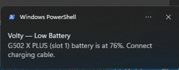
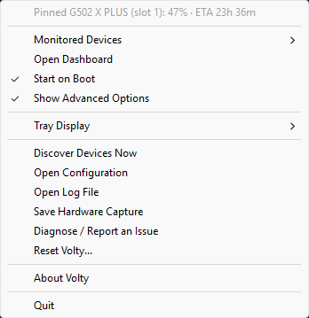

# Install and run

## Download a release

Download the latest
[Volty release](https://github.com/PhilippPolterauer/volty-rs/releases/latest).
For a standard 64-bit Windows PC, choose
`Volty-vX.Y.Z-x86_64-pc-windows-msvc.exe`. The matching `.sha256` file contains
the executable's SHA-256 checksum. Volty is a standalone executable; no
installer or additional runtime file is needed.

Save the executable where you want to keep it, then double-click it. Volty
starts in the Windows notification area. On first launch, choose whether to
start Volty automatically when you sign in. This setting applies to the current
Windows user, does not require administrator privileges, and can be changed
later from the tray menu. If enabled, Windows starts Volty from the executable's
current location, so keep the file there. If you launch a different Volty copy
while Start on Boot is enabled, Volty asks whether to change the startup entry
to that executable; declining leaves the existing entry unchanged. If you
manually install a newer release in a different location, launch it and confirm
the change. The in-app updater replaces the executable in place, preserving the
startup path; its restart does not show a second confirmation.

## Use the tray app

Volty monitors supported devices while it runs. The icon shows the lowest
reported battery level by default; you can pin a device or choose a numeric
percentage icon. Hover over the icon for a compact line per device, including
its name, percentage, estimated remaining time when available, and last-seen age.
The battery icon adapts its outline for readability in light and dark Windows
themes, and percentage digits use Segoe UI. A reading is marked `stale` after
the configured stale period.

### If no battery reading appears

The tray status **No battery readings · check Monitored Devices** means Volty
has no battery readings from monitored devices right now. Right-click the icon
and open **Monitored Devices**: checked devices are monitored; uncheck a device
to exclude it, or check it to include it.

If your device is missing from the list, make sure it is on and connected, then
right-click **Show Advanced Options → Discover Devices Now** to scan again.
Volty can only read battery data that Windows exposes through a supported
interface. If the device still does not appear, check the
[tested devices and limitations](device-support.md).

Low-battery alerts are Windows notifications. They are enabled by default and
fire at 20%, 10%, and 5% once per discharge cycle. Their thresholds and repeat
cooldown are configurable.

Right-click the icon for the compact menu: manage **Monitored Devices**, toggle
**Start on Boot**, check for updates, open **About Volty**, or quit. Volty checks
for updates on startup and once per day while running. When a stable GitHub
release is available, Windows shows a notification and the tray item changes to
**Update available!**; selecting it asks before downloading. You can also select
**Check for Updates...** to check manually. Volty verifies the executable
against the release's SHA-256 file, then restarts through a temporary helper that
replaces the executable at its current location. The existing **Start on Boot**
entry keeps pointing to that same path. The destination folder must be writable
by your Windows user; if an update cannot be installed, Volty restarts the
previous version and reports the error. Existing installations must install the
first release that includes this updater manually; later releases can be
installed from the tray menu.

**Show Advanced Options** reveals manual discovery, tray customization,
configuration and log access, hardware capture, diagnostics, and reset. The
advanced-menu choice is saved locally; **Reset Volty** returns to the compact
menu.

The native tray menu follows the current Windows light or dark theme. The
dashboard uses the same system-aware appearance.

## Battery history dashboard

Left-click the tray icon to open the local dashboard in a native WebView2
window. It starts with a summary of tracked devices, data points, and online
devices, followed by per-device battery details and history charts. Use the
device selector or search field to narrow the view. In the native window, the
Refresh button reloads the latest saved history. The layout adapts to narrow
windows, and its colors follow the Windows light or dark theme. If WebView2 is
unavailable, Volty opens a read-only HTML snapshot in your default browser.

The native window also provides local history and diagnostic-file management.
See [Dashboard options and data controls](diagnostics.md#battery-history-dashboard)
for details.

Unchecking a device in **Monitored Devices** excludes it from tray status,
icon percentage, low-battery alerts, and battery history. Unlisted devices are
monitored by default.

## Tray display

Under **Show Advanced Options → Tray Display**, choose:

- **Battery** (default): a battery glyph filled to the percentage.
- **Percentage**: the number drawn using a built-in pixel font. The icon shows
  the number without a percent sign; unknown levels use the neutral battery
  icon.

The same submenu can pin the icon to a discovered device. **Lowest battery**
restores the default. If a pinned device is missing or unchecked, Volty falls
back to the lowest monitored percentage and reports **Pinned device
unavailable**. The pin remains saved and takes effect again if the device
returns.

Display mode and pin are stored in
`%LOCALAPPDATA%\Volty\device-state.sqlite3`, not in `config.toml`.

## Reset Volty

**Reset Volty** asks for confirmation, deletes `%APPDATA%\Volty\config.toml` and
`%LOCALAPPDATA%\Volty\device-state.sqlite3`, disables **Start on Boot**, and
clears the first-run startup preference. Volty then reinitializes with fresh
defaults, including the compact tray menu. The startup prompt appears again on
the next launch. Logs and the battery history database are retained.
